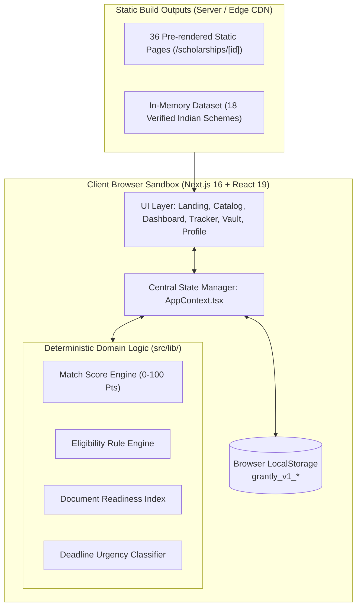
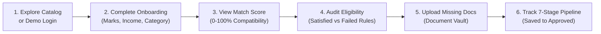

# GRANTLY — Unified Scholarship Discovery & Management Platform

> **A modern, fintech-grade EdTech SaaS platform designed to transform scholarship discovery, deterministic eligibility evaluation, application tracking, and document management for Indian students.**
>
> 🌐 **Live Demo:** [[Visit GRANTLY](https://your-live-link.vercel.app)](https://grantly-platform.vercel.app)

[](https://nextjs.org/)
[](https://react.dev/)
[](https://www.typescriptlang.org/)
[](https://tailwindcss.com/)
[](https://greensock.com/)
[](LICENSE)

---

## 📋 Table of Contents

- [1. Introduction & Problem Statement](#1-introduction--problem-statement)
- [2. Project Objectives](#2-project-objectives)
- [3. Key Features](#3-key-features)
- [4. Technology Stack](#4-technology-stack)
- [5. System Architecture Overview](#5-system-architecture-overview)
- [6. Visual Previews & Screenshots](#6-visual-previews--screenshots)
- [7. Project Folder Structure](#7-project-folder-structure)
- [8. Installation & Setup Instructions](#8-installation--setup-instructions)
- [9. Environment Variables Configuration](#9-environment-variables-configuration)
- [10. Available Execution Commands](#10-available-execution-commands)
- [11. End-to-End User Workflows](#11-end-to-end-user-workflows)
- [12. Technical Documentation Index](#12-technical-documentation-index)
- [13. Future Roadmap & Enhancements](#13-future-roadmap--enhancements)
- [14. Contributors](#14-contributors)
- [15. License](#15-license)

---

## 1. Introduction & Problem Statement

### The Problem
Every academic year, Indian students forfeit hundreds of crores of rupees in government, corporate CSR, and philanthropic trust scholarships. The scholarship landscape in India suffers from severe structural bottlenecks:

1. **Fragmentation & Opaque Portals**: Schemes are dispersed across central portals (NSP), state departments, corporate CSR foundations (Reliance, Infosys, HDFC), and private trusts without a single discovery point.
2. **Convoluted Qualification Rules**: Eligibility guidelines involve multi-tier restrictions spanning education level, state domicile, family income ceilings, minimum mark cutoffs, gender benefits, and social reservation quotas. Students struggle to determine if they qualify.
3. **Disorganized Paperwork & Missed Deadlines**: Applications often require 5 to 8 official certificates (Income slips, Tahsildar caste documents, Bonafide letters). Missing a single document or deadline causes immediate rejection.
4. **Lack of Lifecycle Tracking**: Once submitted, students have no structured way to manage portal reference numbers, track review stages, or contrast competing offers.

### The Solution: GRANTLY
**GRANTLY** unites discovery, deterministic compliance checking, and application lifecycle tracking into a single digital workspace. Built with modern SaaS design principles, it delivers zero-latency static performance, strict data privacy, and explainable intelligence.

---

## 2. Project Objectives

- **Democratize Scholarship Access**: Provide a clean, unified discovery hub for school, undergraduate, postgraduate, and technical scholars across India.
- **Eliminate Eligibility Ambiguity**: Replace generic percentage estimates with an explainable, deterministic rule engine that audits student qualifications with zero black-box obscurity.
- **Ensure Application Readiness**: Cross-reference required certificates directly against the student's Document Vault to prevent disqualification due to missing paperwork.
- **Guarantee Student Privacy**: Protect sensitive financial declarations and documents through client-side local storage sandboxing without third-party data tracking.
- **Deliver World-Class User Experience**: Combine fintech design fidelity (`#5B4BDB` Purple, `#18B6A4` Teal, `#171B2D` Navy) with hardware-accelerated GSAP scroll storytelling.

---

## 3. Key Features

### 🧠 1. Explainable Match Scoring Engine (0–100 Pts)
- Computes compatibility across 5 weighted vectors:
  - **Academic Score Match** (25 pts): Marks vs minimum cutoff benchmark.
  - **Financial Need Match** (25 pts): Income tier and ceiling compliance.
  - **Education Level Match** (20 pts): Direct level alignment.
  - **Category & Gender Match** (15 pts): Affirmative action and women-in-STEM benefits.
  - **State Domicile Match** (15 pts): Home state vs All-India eligibility.
- Accompanied by transparent, human-readable point attribution reasons.

### 🛡️ 2. Deterministic Smart Eligibility Checker
- Audits student profile credentials against declared mandatory criteria.
- Returns explicit compliance statuses: `ELIGIBLE`, `POTENTIALLY_ELIGIBLE`, `NOT_ELIGIBLE`, or `PROFILE_INCOMPLETE`.
- Generates an itemized audit matrix showing declared values, required benchmarks, and remediation steps.

### 📊 3. 7-Stage Application Lifecycle Pipeline
- Track opportunities from inception to award:
  $$\text{Saved} \longrightarrow \text{Planning to Apply} \longrightarrow \text{Applied} \longrightarrow \text{Under Review} \longrightarrow \text{Shortlisted} \longrightarrow \text{Approved} \ / \ \text{Rejected}$$
- Record official portal acknowledgement numbers, personal notes, and submission milestones.

### 🗄️ 4. Local Document Vault & Readiness Index
- Indexes 9 standard Indian scholarship certificates (Aadhaar, Tahsildar Income, Caste, Domicile, Marksheets, Bonafide, Bank Passbook, Photograph, SOP).
- Automatically calculates an **Application Readiness Index** (0–100%), signaling whether an application is 100% ready for submission.

### ⚖️ 5. Side-by-Side Comparison Dock
- Compare up to 3 scholarships simultaneously in a synchronized floating matrix.
- Contrast benefits, deadlines, academic cutoffs, income limits, and document checklists.

### ⏳ 6. Dynamic Deadline Intelligence
- Categorizes approaching deadlines into **Closing This Week** (<= 7 days, Red), **Due This Month** (<= 30 days, Amber), and **Open** (Blue/Green).
- Dedicated in-app notification center alerts students to urgent deadlines.

### 🎨 7. Connected Physical Card Drop & Stacking Scroll Experience
- Pinned GSAP ScrollTrigger sequence connecting "How It Works" to "Featured Indian Scholarships".
- Physical card stacking (Steps 01 to 04) followed by a gravity card drop, impact landing bounce, and simultaneous 4-corner grid scatter.

---

## 4. Technology Stack

| Layer | Technology | Version | Purpose |
| :--- | :--- | :--- | :--- |
| **Framework** | Next.js (App Router) | `16.4.5` | Static site generation (`generateStaticParams`), Turbopack compiler, partial prefetching. |
| **UI Runtime** | React & React DOM | `19.3.0` | Client component architecture, concurrent rendering hooks. |
| **Language** | TypeScript | `^5` | Strict static typing across all models, calculation engines, and props. |
| **Styling** | Tailwind CSS v4 | `^4` | Utility-first styling with `@tailwindcss/turbopack` and CSS custom properties. |
| **Motion & Scroll**| GSAP & @gsap/react | `^3.15.1` / `^2.1.2` | Advanced scroll storytelling, card stacking, physical drops, and gradient reveals. |
| **UI Transitions** | Framer Motion | `^14.10.1` | Modal dialogs, drawer slides, accordion toggles, and layout animations. |
| **Data Viz** | Recharts | `^3.10.1` | Interactive dashboard KPI and scholarship match distribution charts. |
| **Icons** | Lucide React | `^1.70.0` | Accessible, tree-shakeable SVG icon collection. |
| **Micro-Effects** | Canvas Confetti | `^1.9.4` | Milestone celebration particles on onboarding and application saves. |
| **Persistence** | Browser LocalStorage | W3C Standard | Offline-first client state management keyed with `grantly_v1_*`. |
| **Code Quality** | ESLint & Next Linter | `^9` / `16.4.5` | Code analysis, React Hook verification, and syntax enforcement. |

---

## 5. System Architecture Overview

GRANTLY operates as a high-performance, client-orchestrated web application where domain engines run in the client sandbox with pre-rendered static assets.



> For comprehensive architecture blueprints, sequence diagrams, and security analysis, see [`docs/architecture/SYSTEM_ARCHITECTURE.md`](./docs/architecture/SYSTEM_ARCHITECTURE.md).

---

## 6. Visual Previews & Screenshots

> 📷 **Screenshot Placeholder 1: Landing Page & Connected Scroll Experience**  
> *Hero section featuring the animated gradient reveal, dual tilted vertical marquee, and the pinned 4-step card stacking sequence.*

> 📷 **Screenshot Placeholder 2: Scholarship Discovery & Faceted Filters**  
> *The `/scholarships` catalog featuring full-text search, sidebar filters (Category, Domicile, Level, Award), and high-match badges.*

> 📷 **Screenshot Placeholder 3: Explainable Eligibility Report Card**  
> *Detailed scholarship view (`/scholarships/[id]`) showing the multi-condition audit matrix with green satisfied checks and action items.*

> 📷 **Screenshot Placeholder 4: 7-Stage Application Lifecycle Tracker**  
> *The `/applications` Kanban board tracking student applications across Planning, Applied, Under Review, and Approved.*

> 📷 **Screenshot Placeholder 5: Document Vault & Readiness Index**  
> *The `/documents` vault showing uploaded Aadhaar, Income, and Marksheet certificates with 100% readiness verification.*

---

## 7. Project Folder Structure

```
GRANTLY/
├── docs/                                  # Complete Technical Documentation
│   ├── README.md                          # Documentation index and overview
│   ├── INSTALLATION.md                    # Setup, dependencies, and execution guide
│   ├── architecture/
│   │   └── SYSTEM_ARCHITECTURE.md         # Comprehensive system architecture & diagrams
│   ├── requirements/
│   │   └── SRS.md                         # IEEE-inspired Software Requirements Specification
│   ├── database/
│   │   └── DATABASE_DOCUMENTATION.md      # Data models, ER diagrams, and SQL blueprints
│   └── user-guide/
│       └── USER_GUIDE.md                  # Step-by-step student user guide & FAQs
│
├── src/
│   ├── app/                               # Next.js 16 App Router Routes
│   │   ├── applications/page.tsx          # 7-stage application lifecycle tracker
│   │   ├── dashboard/page.tsx             # Analytics KPIs, charts, and recommendations
│   │   ├── documents/page.tsx             # Document Vault & readiness matrix
│   │   ├── eligibility/page.tsx           # Standalone Smart Eligibility Checker
│   │   ├── forgot-password/page.tsx       # Password recovery simulation
│   │   ├── login/page.tsx                 # Login screen with 1-click demo entry
│   │   ├── notifications/page.tsx         # Notification center & deadline alerts
│   │   ├── onboarding/page.tsx            # 4-step student onboarding wizard
│   │   ├── profile/page.tsx               # Comprehensive profile editor
│   │   ├── saved/page.tsx                 # Bookmarked scholarships hub
│   │   ├── scholarships/
│   │   │   ├── page.tsx                   # Search, faceted filters, and sorting catalog
│   │   │   └── [id]/
│   │   │       ├── page.tsx               # Static route wrapper (generateStaticParams)
│   │   │       └── ScholarshipDetailClient.tsx # Interactive scholarship detail view
│   │   ├── settings/page.tsx              # System preferences and demo data reset
│   │   ├── signup/page.tsx                # Student registration wizard
│   │   ├── globals.css                    # Tailwind v4 directives & design tokens
│   │   ├── layout.tsx                     # Root layout with AppProvider
│   │   └── page.tsx                       # Landing page with GSAP animations
│   │
│   ├── components/                        # Modular React Components
│   │   ├── common/                        # Badge, Modal, ProgressBar, EmptyState, Logo
│   │   ├── dashboard/                     # AnalyticsChart (Recharts visualization)
│   │   ├── landing/                       # HeroSection, ConnectedCardExperience, CTA
│   │   ├── layout/                        # Navbar, Footer, Sidebar, TopNav, ComparisonDrawer
│   │   └── scholarships/                  # ScholarshipCard, ScholarshipFilters
│   │
│   ├── context/
│   │   └── AppContext.tsx                 # Centralized state & LocalStorage sync
│   │
│   ├── data/
│   │   ├── scholarships.ts                # 18 realistic verified Indian scholarship schemes
│   │   └── mockStudent.ts                 # Priya Sharma sample student data & documents
│   │
│   ├── lib/                               # Pure Deterministic Algorithmic Engines
│   │   ├── animations.ts                  # GSAP gradient reveal & tween utilities
│   │   ├── deadline.ts                    # Deadline calculation & urgency classification
│   │   ├── eligibility.ts                 # Multi-point deterministic rule engine
│   │   ├── matchScore.ts                  # 100-point weighted matching algorithm
│   │   ├── readiness.ts                   # Document Vault cross-referencing engine
│   │   └── recommendation.ts              # Multi-criteria ranking and sorting logic
│   │
│   └── types/
│       └── index.ts                       # Strict TypeScript models and interfaces
│
├── next.config.ts                         # Next.js configuration (Turbopack, cache)
├── package.json                           # Project manifest and dependencies
├── tsconfig.json                          # Strict TypeScript compiler options
└── README.md                              # Project overview (this document)
```

---

## 8. Installation & Setup Instructions

### Prerequisites
- **Node.js**: `v18.18.0` or higher (tested on `v22.13.1`)
- **npm**: `v9.0.0` or higher (tested on `10.9.2`)

### 1. Clone the Repository
```bash
git clone <repository-url> grantly
cd grantly
```

### 2. Install Dependencies
```bash
npm install
```

### 3. Launch the Development Server
```bash
npm run dev
```
Open [http://localhost:3000](http://localhost:3000) in your browser. The application runs with Turbopack acceleration.

---

## 9. Environment Variables Configuration

GRANTLY is an **offline-first, zero-external-API client application**. All scholarship datasets, matching algorithms, and storage mechanisms execute directly inside the browser.

**No mandatory `.env` file is required.**

Optional configuration (`.env.local`):
```bash
# Optional: Canonical application URL
NEXT_PUBLIC_APP_URL=http://localhost:3000

# Optional: Environment flag
NODE_ENV=development
```

---

## 10. Available Execution Commands

| Command | Action |
| :--- | :--- |
| `npm run dev` | Starts local Next.js development server with Turbopack on `http://localhost:3000`. |
| `npm run build` | Compiles application and pre-renders all 36 static pages. |
| `npm run start` | Runs the compiled production server from `.next/`. |
| `npm run lint` | Executes ESLint to check for code quality and syntax compliance. |
| `npx tsc --noEmit` | Executes strict TypeScript compilation verification. |

---

## 11. End-to-End User Workflows



1. **One-Click Demo Experience**: Visit `/login` and select **Continue as Priya Sharma (Demo Student)** to access an already-configured profile.
2. **Personalized Discovery**: Visit `/scholarships` and toggle **Only Show Eligible** to view schemes where your profile clears all criteria.
3. **Comparing Opportunities**: Flag up to 3 scholarships to view their benefits side-by-side in the floating comparison drawer.
4. **Document Preparation**: Upload required certificates to the **Document Vault** (`/documents`) to bring your Application Readiness score to 100%.
5. **Pipeline Tracking**: Advance applications across 7 Kanban stages (`/applications`) with personal notes and portal reference IDs.

---

## 12. Technical Documentation Index

For in-depth technical details, please consult our dedicated documentation files:

- 📖 [**Documentation Index** (`docs/README.md`)](./docs/README.md)
- ⚙️ [**Installation & Setup Guide** (`docs/INSTALLATION.md`)](./docs/INSTALLATION.md)
- 🏛️ [**System Architecture Documentation** (`docs/architecture/SYSTEM_ARCHITECTURE.md`)](./docs/architecture/SYSTEM_ARCHITECTURE.md)
- 📝 [**Software Requirements Specification (SRS)** (`docs/requirements/SRS.md`)](./docs/requirements/SRS.md)
- 🗄️ [**Database & Data Architecture** (`docs/database/DATABASE_DOCUMENTATION.md`)](./docs/database/DATABASE_DOCUMENTATION.md)
- 🎓 [**Student User Guide** (`docs/user-guide/USER_GUIDE.md`)](./docs/user-guide/USER_GUIDE.md)

---

## 13. Future Roadmap & Enhancements

- [ ] **DigiLocker API Integration**: Automatic retrieval and cryptographic verification of Aadhaar, caste, and academic marks slips directly from DigiLocker.
- [ ] **Enterprise Multi-Tenant Backend**: Migration from LocalStorage to PostgreSQL with Prisma ORM and encrypted AWS S3 document vaulting.
- [ ] **Automated WhatsApp / SMS Deadline Alerts**: Proactive reminders delivered 3 days before major central and state scholarship closing gates.
- [ ] **Institutional Counselor Portal**: Dedicated dashboard enabling college financial aid officers to verify student eligibility in bulk.
- [ ] **Multi-Language Regional Support**: Localization in Hindi, Marathi, Tamil, Telugu, Bengali, and Kannada.

---

## 14. Contributors

GRANTLY is conceptualized and maintained by:

- **Lead Architect & Frontend Engineer**: Valay Patel (*Project Creator*)
- **Technical Documentation & System Design**: Antigravity Assistant Team
- **Open-Source Contributors**: [TODO: Community contributor list placeholder]

Contributions, feedback, and issue reports are welcome via pull requests and GitHub Issues.

---

## 15. License

This project is licensed under the **MIT License**. See the [LICENSE](LICENSE) file for complete terms.

```
Copyright (c) 2026 GRANTLY Development Team

Permission is hereby granted, free of charge, to any person obtaining a copy
of this software and associated documentation files (the "Software"), to deal
in the Software without restriction, including without limitation the rights
to use, copy, modify, merge, publish, distribute, sublicense, and/or sell
copies of the Software...
```
