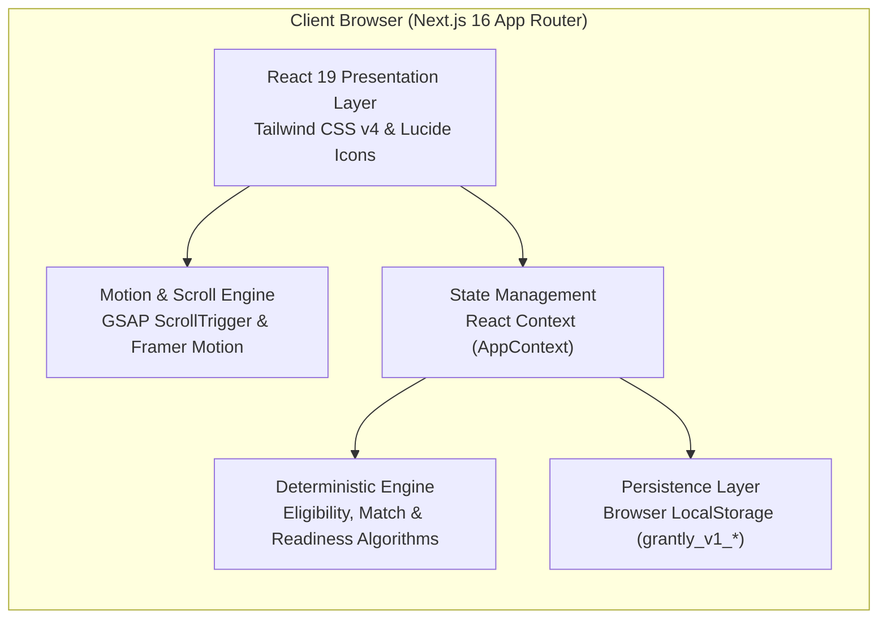

# GRANTLY Documentation Index

Welcome to the official technical documentation for **GRANTLY – Unified Scholarship Discovery & Management Platform**.

This documentation suite provides a comprehensive guide for developers, system architects, students, evaluators, and open-source contributors. It covers every aspect of the platform: from architectural blueprints and IEEE-style Software Requirements Specifications (SRS) to installation protocols, local data architecture, and end-user workflows.

---

## 📚 Documentation Directory

| Document | File Path | Target Audience | Description |
| :--- | :--- | :--- | :--- |
| **System Architecture** | [`docs/architecture/SYSTEM_ARCHITECTURE.md`](./architecture/SYSTEM_ARCHITECTURE.md) | Architects, Tech Leads, Engineers | Complete architecture blueprint, component hierarchies, state flows, Mermaid sequence diagrams, and security design. |
| **Software Requirements Specification (SRS)** | [`docs/requirements/SRS.md`](./requirements/SRS.md) | Product Managers, QA, Engineers | IEEE-inspired specification with numbered functional (`FR-xx`) and non-functional (`NFR-xx`) requirements, use case diagrams, and workflows. |
| **Database & Data Architecture** | [`docs/database/DATABASE_DOCUMENTATION.md`](./database/DATABASE_DOCUMENTATION.md) | Backend Engineers, Database Architects | Data modeling, Mermaid ER diagrams, LocalStorage schema, TypeScript entities, validation rules, and future SQL migration schemas. |
| **User Guide** | [`docs/user-guide/USER_GUIDE.md`](./user-guide/USER_GUIDE.md) | Students, Evaluators, End Users | Step-by-step walkthrough covering onboarding, search, match score interpretation, eligibility audits, pipeline tracking, and document vaulting. |
| **Installation & Setup** | [`docs/INSTALLATION.md`](./INSTALLATION.md) | Developers, DevOps, Evaluators | Prerequisites, package installations, dependencies with versions and purposes, execution scripts, and troubleshooting. |
| **Project README** | [`README.md`](../README.md) | General Public, Evaluators, GitHub | High-level overview, feature highlights, quick-start guide, and technology stack. |

---

## 🎯 Platform At A Glance

**GRANTLY** is an EdTech SaaS platform designed to solve scholarship discovery, evaluation, and application tracking for Indian students. Built with Next.js 16, React 19, TypeScript, Tailwind CSS v4, GSAP, and Framer Motion, it features:

- **Deterministic Smart Eligibility Checker**: A multi-point rule engine that audits student qualifications against scholarship criteria with zero black-box ambiguity.
- **Explainable Match Engine**: A 100-point weighted scoring algorithm factoring education level, academic marks, financial need, category reservation, and state domicile.
- **7-Stage Application Lifecycle Pipeline**: Kanban-style tracker taking students from *Saved* through *Planning*, *Applied*, *Under Review*, *Shortlisted*, to *Approved* or *Rejected*.
- **Local Document Vault & Readiness Index**: An offline-first document manager that cross-references required paperwork and scores whether an application is 100% ready for submission.
- **Side-by-Side Opportunity Comparison**: A synchronized comparison drawer evaluating up to 3 scholarships across financial aid, deadlines, and documentation.
- **Zero-Latency Client State Persistence**: All student profile data, bookmarks, pipeline stages, and document metadata persist reliably in browser `LocalStorage`.

---

## 🏗️ Technology Stack Summary

- **Framework**: Next.js 16.4.5 (App Router with Turbopack)
- **Runtime & Language**: React 19.3.0, TypeScript 5 (Strict Mode)
- **Styling**: Tailwind CSS v4 with `@tailwindcss/turbopack`
- **Animations**: GSAP 3.15.1, `@gsap/react` 2.1.2, Framer Motion 14.10.1, Canvas Confetti 1.9.4
- **Analytics & Visualizations**: Recharts 3.10.1
- **Icons**: Lucide React 1.70.0
- **Storage**: Browser LocalStorage (`grantly_v1_*`)

---

## 🔍 How To Read This Documentation

1. **For Developers Setting Up Locally**:
   - Begin with [`docs/INSTALLATION.md`](./INSTALLATION.md) to set up your Node.js environment and launch Turbopack.
   - Read [`docs/architecture/SYSTEM_ARCHITECTURE.md`](./architecture/SYSTEM_ARCHITECTURE.md) to understand state management, routing, and data flow.

2. **For Evaluators & Reviewers**:
   - Start with [`README.md`](../README.md) for the project overview and objectives.
   - Inspect [`docs/requirements/SRS.md`](./requirements/SRS.md) to review implemented functional capabilities versus proposed future integrations.
   - Follow [`docs/user-guide/USER_GUIDE.md`](./user-guide/USER_GUIDE.md) to test the platform using the pre-seeded **Priya Sharma** demo profile.

3. **For Backend & Database Engineers**:
   - Consult [`docs/database/DATABASE_DOCUMENTATION.md`](./database/DATABASE_DOCUMENTATION.md) to understand the current TypeScript data models and review the proposed production relational schema.

---

## 🤝 Maintenance & Contributions

When updating GRANTLY:
- Keep documentation updated alongside any changes to TypeScript types (`src/types/index.ts`) or calculation utilities (`src/lib/`).
- Ensure all diagrams adhere to valid Mermaid syntax.
- Run `npm run lint` and `npx tsc --noEmit` before submitting changes.

