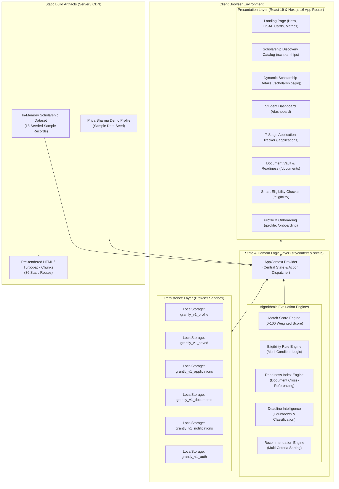
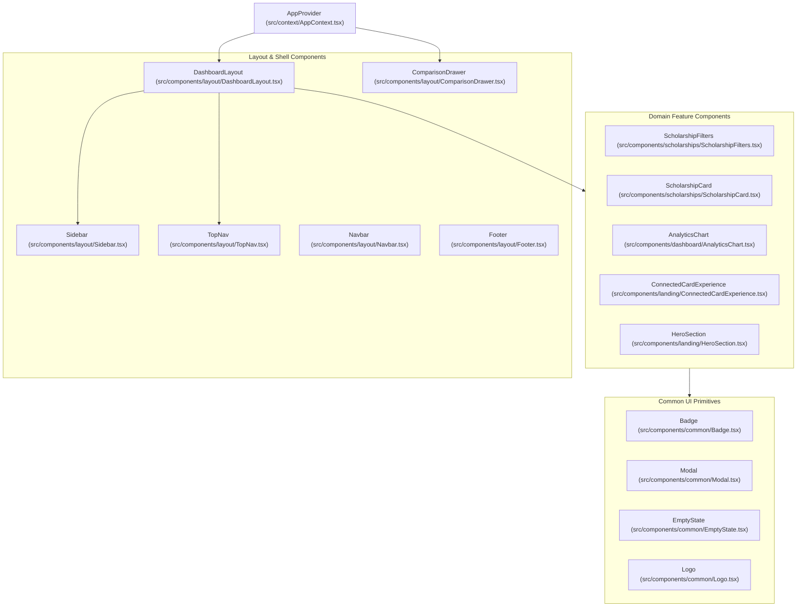
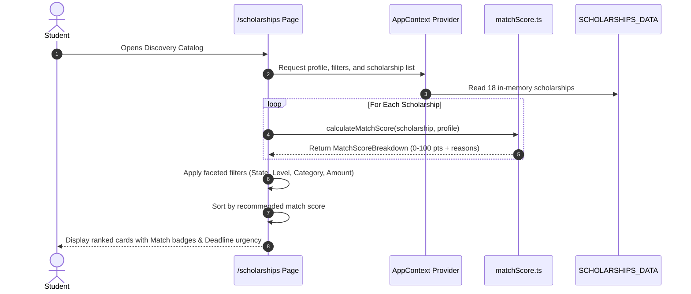
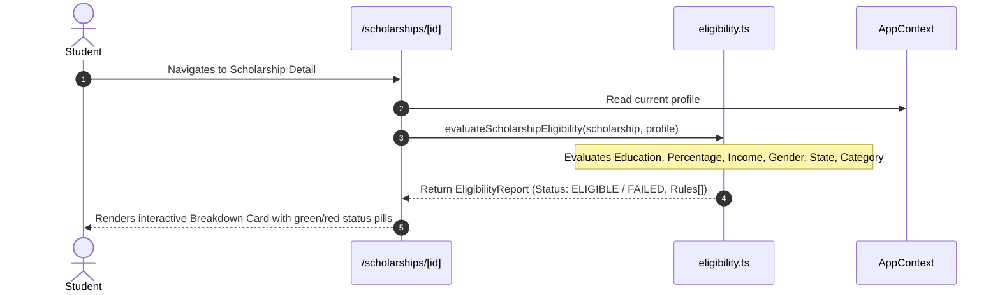
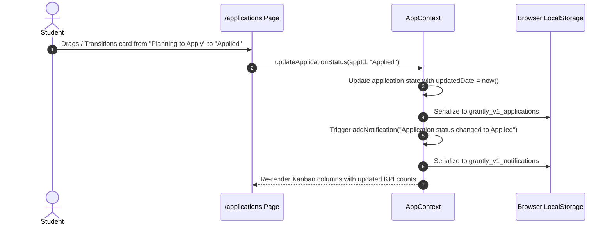
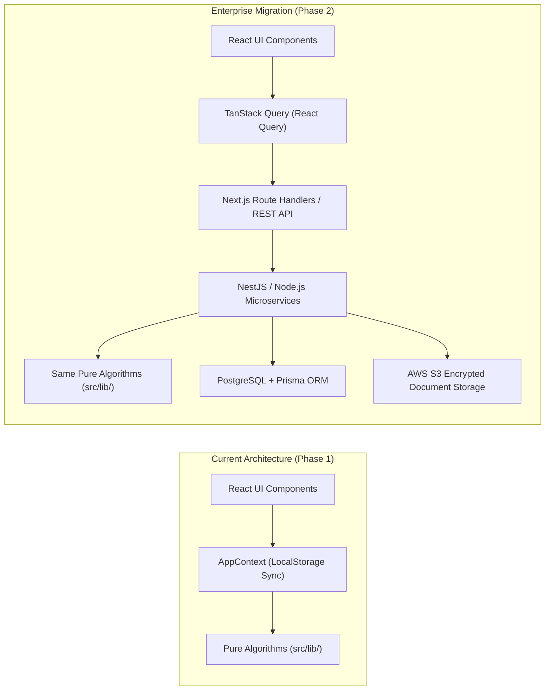

# GRANTLY — System Architecture Documentation

This document describes the architectural design, component hierarchy, state flow, deterministic rule engine, and data persistence models of **GRANTLY – Unified Scholarship Discovery & Management Platform**.

---

## 📋 Table of Contents

- [1. Executive Summary & Design Principles](#1-executive-summary--design-principles)
- [2. High-Level System Architecture](#2-high-level-system-architecture)
- [3. Frontend Architecture](#3-frontend-architecture)
- [4. Component Architecture](#4-component-architecture)
- [5. Domain Logic & Algorithmic Engines](#5-domain-logic--algorithmic-engines)
  - [5.1 Explainable Match Score Algorithm (100 Pts)](#51-explainable-match-score-algorithm-100-pts)
  - [5.2 Deterministic Eligibility Rule Engine](#52-deterministic-eligibility-rule-engine)
  - [5.3 Application Readiness Index](#53-application-readiness-index)
  - [5.4 Deadline Intelligence & Countdown Calculations](#54-deadline-intelligence--countdown-calculations)
- [6. Data Flow & Sequence Diagrams](#6-data-flow--sequence-diagrams)
  - [6.1 Discovery & Personalized Matching Flow](#61-discovery--personalized-matching-flow)
  - [6.2 Eligibility Evaluation Flow](#62-eligibility-evaluation-flow)
  - [6.3 7-Stage Application Lifecycle Flow](#63-7-stage-application-lifecycle-flow)
  - [6.4 Document Vault & Readiness Flow](#64-document-vault--readiness-flow)
- [7. Authentication & Session Architecture](#7-authentication--session-architecture)
- [8. Persistence & Storage Architecture](#8-persistence--storage-architecture)
- [9. Security & Privacy Considerations](#9-security--privacy-considerations)
- [10. Scalability & Future Backend Migration Path](#10-scalability--future-backend-migration-path)

---

## 1. Executive Summary & Design Principles

Indian students frequently forfeit millions of rupees in academic funding due to fragmented state and central portals, convoluted qualifying guidelines, missed deadlines, and disorganized paperwork.

**GRANTLY** solves this through a unified digital workspace designed around five core principles:

1. **Deterministic Transparency (Zero Black-Box Scoring)**: Rather than using opaque neural predictions, eligibility is evaluated through an explainable multi-condition rule engine that breaks down exactly which condition passed, failed, or requires attention.
2. **Browser-Side Prototype State**: Profile declarations and document metadata are persisted in `localStorage`. This is user-editable storage, not a secure account or suitable storage for identity documents.
3. **Static Route Generation**: Scholarship detail routes are generated at build time from the local seed dataset; generation does not validate record accuracy or guarantee a particular load time.
4. **Synchronized Reactive State**: A centralized React Context (`AppContext`) coordinates profile updates, bookmark toggles, application pipeline shifts, and document uploads with automatic `LocalStorage` serialization.
5. **Modern SaaS Aesthetic**: An off-white fintech visual design (`#F8F9FC`), Deep Navy typography (`#171B2D`), Royal Purple primary highlights (`#5B4BDB`), Vibrant Teal progress indicators (`#18B6A4`), and GSAP scroll storytelling.

---

## 2. High-Level System Architecture

GRANTLY operates as a high-performance, client-orchestrated Next.js 16 application with static dataset preloading and browser storage synchronization.



---

## 3. Frontend Architecture

GRANTLY leverages the **Next.js 16 App Router** with React 19 server and client components:

### App Router Route Tree

```
src/app/
├── layout.tsx                    # Root HTML layout with AppProvider & metadata
├── globals.css                   # Tailwind v4 directives, custom gradient tokens
├── page.tsx                      # Landing page with GSAP scroll storytelling
├── login/page.tsx                # Authentication screen with demo autofill
├── signup/page.tsx               # Account creation wizard
├── forgot-password/page.tsx      # Password recovery simulation
├── onboarding/page.tsx           # 4-step student profile onboarding
├── dashboard/page.tsx            # Analytics KPIs, recommendations, application pipeline
├── scholarships/
│   ├── page.tsx                  # Search, faceted filters, and sorting catalog
│   └── [id]/
│       ├── page.tsx              # Static route wrapper with generateStaticParams()
│       └── ScholarshipDetailClient.tsx # Interactive scholarship detail view
├── applications/page.tsx         # 7-stage Kanban application pipeline
├── documents/page.tsx            # Document Vault with local upload simulation
├── eligibility/page.tsx          # Standalone explainable rule engine evaluator
├── notifications/page.tsx        # System alerts & deadline notifications
├── profile/page.tsx              # Comprehensive student profile editor
└── settings/page.tsx             # Preferences, theme toggles, and data reset
```

### Static Pre-rendering (`generateStaticParams`)

The dynamic route `/scholarships/[id]` leverages Next.js 16 `generateStaticParams()` to pre-render all 18 scholarship schemes into static HTML at build time:

```typescript
export async function generateStaticParams() {
  return SCHOLARSHIPS_DATA.map((scholarship) => ({
    id: scholarship.id,
  }));
}
```

This guarantees:
- Sub-50ms Time to First Byte (TTFB) when visiting any scholarship scheme.
- Full search engine crawlability and OpenGraph indexing.
- Zero server database latency during navigation.

---

## 4. Component Architecture

The component hierarchy is structured for maximum modularity and reusability:



---

## 5. Domain Logic & Algorithmic Engines

All business logic is isolated in pure, deterministic TypeScript modules under `src/lib/`.

### 5.1 Explainable Match Score Algorithm (100 Pts)

Implemented in [`src/lib/matchScore.ts`](file:///e:/grantly/src/lib/matchScore.ts), this deterministic heuristic calculates an indicative 0–100 compatibility rating from five dimensions. It is not an AI model or funding probability. A profile is required; missing profiles receive no baseline score, and a failed mandatory eligibility rule caps the total at 49.

| Dimension | Max Points | Weight | Criteria Logic |
| :--- | :--- | :--- | :--- |
| **Education Level** | 20 pts | 20% | Direct level match (e.g. Undergraduate matches Undergraduate) or open to all. |
| **Academic Performance** | 25 pts | 25% | Marks >= required + 15% (25 pts), marks >= required (20 pts), borderline within 5% (8 pts), below (0 pts). |
| **Financial Need** | 25 pts | 25% | Income <= 50% of ceiling (25 pts), income <= ceiling (20 pts), exceeding ceiling (0 pts). |
| **Category & Gender** | 15 pts | 15% | Matching targeted social category and gender criteria recorded in the data. |
| **State Domicile** | 15 pts | 15% | All-India schemes (15 pts), direct state domicile match (15 pts), other states (0 pts). |

### 5.2 Preliminary Eligibility Rule Engine

Implemented in [`src/lib/eligibility.ts`](file:///e:/grantly/src/lib/eligibility.ts), this engine evaluates declared requirements against the student's profile:

- **Input**: `Scholarship` object + `StudentProfile` object.
- **Output**: `EligibilityReport` comparing criteria present in the record with profile data. It is preliminary and the data may be incomplete or stale. It now checks education, marks, income, gender, domicile, category, course, disability, and age when those requirements are supplied.
  - `status`: `'ELIGIBLE' | 'POTENTIALLY_ELIGIBLE' | 'NOT_ELIGIBLE' | 'PROFILE_INCOMPLETE'`
  - `overallScore`: Percentage of recorded mandatory criteria satisfied; zero when no mandatory rules are available.
  - `rules`: Array of `RuleEvaluation` entries containing name, student value, required benchmark, and status (`satisfied`, `failed`, or `missing_info`).
  - `actionItems`: Next steps based on failed or missing profile details.

Provider confirmation is still required before applying.

### 5.3 Application Readiness Index

Implemented in [`src/lib/readiness.ts`](file:///e:/grantly/src/lib/readiness.ts):
- Compares required document types against document metadata records in the vault (file contents are not stored).
- Includes profile completion and preliminary eligibility in the checklist score.
- `isReadyToApply` is true only when the profile is complete, recorded mandatory criteria pass, and every required document type is present. It does not mean official approval.

### 5.4 Deadline Intelligence & Countdown Calculations

Implemented in [`src/lib/deadline.ts`](file:///e:/grantly/src/lib/deadline.ts):
- Computes calendar-day difference using the current India date and the recorded ISO deadline.
- Classifies urgency:
  - `isClosingSoon`: 7 days or fewer remaining (Red alert).
  - `badgeType`: `critical` (7 days or fewer), `warning` (8–30 days), `normal` (more than 30 days), or `expired`.
  - `isExpired`: Deadline has passed. Date-only values are compared as calendar days in the `Asia/Kolkata` time zone.

---

## 6. Data Flow & Sequence Diagrams

### 6.1 Discovery & Personalized Matching Flow



### 6.2 Eligibility Evaluation Flow



### 6.3 7-Stage Application Lifecycle Flow



### 6.4 Document Vault & Readiness Flow

```mermaid
sequenceDiagram
    autonumber
    actor Student
    participant Vault as /documents Page
    participant AppCtx as AppContext
    participant ReadyEng as readiness.ts
    participant LS as Browser LocalStorage

    Student->>Vault: Selects a local file for a document record
    Vault->>AppCtx: uploadDocument({ documentType: "Income Certificate", fileName, fileSize })
    AppCtx->>AppCtx: Store metadata, set verified = false, timestamp = now()
    AppCtx->>LS: Serialize to grantly_v1_documents
    Student->>Vault: Views Readiness Matrix
    Vault->>ReadyEng: calculateApplicationReadiness(scholarship, profile, documents)
    ReadyEng-->>Vault: Return preparation score and missing-item checklist
    Vault-->>Student: Show document metadata coverage; file bytes are not retained
```

---

## 7. Authentication & Session Architecture

GRANTLY's current implementation uses a **simulated client-side demo session**, not production authentication:

1. **Pre-Seeded Demo Profile**: By default, the application runs with an authenticated session initialized to **Priya Sharma** (`student-demo-priya`), allowing immediate evaluation of all matching, scoring, and tracking features.
2. **One-Click Demo Switcher**: The Login screen (`/login`) allows one-click demo login or custom login.
3. **Custom Registration Flow**: The Signup wizard gathers profile fields locally and calls the client state action; it does not create or verify a server account.
4. **Session Persistence**: Session state is persisted in `LocalStorage` (`grantly_v1_profile` and `grantly_v1_auth`). Logging out resets session state without destroying public catalog browsing capabilities.

---

## 8. Persistence & Storage Architecture

GRANTLY stores all mutable state in the browser's `LocalStorage` with resilient fallback handling:

| Storage Key | Data Model | Description | Default Fallback |
| :--- | :--- | :--- | :--- |
| `grantly_v1_profile` | `StudentProfile` | Current student profile, marks, income, categories | `DEMO_STUDENT_PROFILE` |
| `grantly_v1_saved` | `string[]` | Array of bookmarked scholarship IDs | `INITIAL_SAVED_IDS` (3 items) |
| `grantly_v1_applications` | `Application[]` | Application pipeline instances with status, notes | `INITIAL_APPLICATIONS` (4 items) |
| `grantly_v1_documents` | `DocumentItem[]` | Document Vault files metadata and verification status | `INITIAL_DOCUMENTS` (5 items) |
| `grantly_v1_notifications` | `NotificationItem[]` | System and deadline notifications | `INITIAL_NOTIFICATIONS` (4 items) |

### Error Resiliency & Safe Initialization

To prevent React 19 hydration mismatches and handle browser storage exceptions (such as private browsing mode):
- The provider renders matching demo defaults on the server and first client pass, then restores localStorage in an effect.
- JSON parsing errors fall back to demo data. Persisted object contents are not fully schema-validated.

---

## 9. Security & Privacy Considerations

- **Prototype Data Limits**: The application contains no backend API for sending profile data, but this has not been verified with network monitoring. Browser localStorage is user-editable and should not hold sensitive identity documents.
- **XSS Mitigation**: React 19's virtual DOM escapes all dynamic values rendered in JSX by default, preventing reflected or stored Cross-Site Scripting.
- **Document Handling**: The vault records file metadata only; it does not retain binary file contents or verify certificates.
- **Content Security**: No dynamic `eval()` or unvalidated `dangerouslySetInnerHTML` is used anywhere in the codebase.

---

## 10. Scalability & Future Backend Migration Path

Because GRANTLY's domain logic in `src/lib/` is completely decoupled from the React presentation layer, migrating to an enterprise backend is straightforward:



Key migration advantages:
1. `src/lib/matchScore.ts` and `src/lib/eligibility.ts` can run unmodified on Node.js backends or PostgreSQL stored procedures.
2. `src/types/index.ts` maps 1:1 to Prisma schemas or SQL tables (documented in [`docs/database/DATABASE_DOCUMENTATION.md`](../database/DATABASE_DOCUMENTATION.md)).
3. The UI components will only swap context hooks with standard API query hooks (`useQuery`, `useMutation`).

