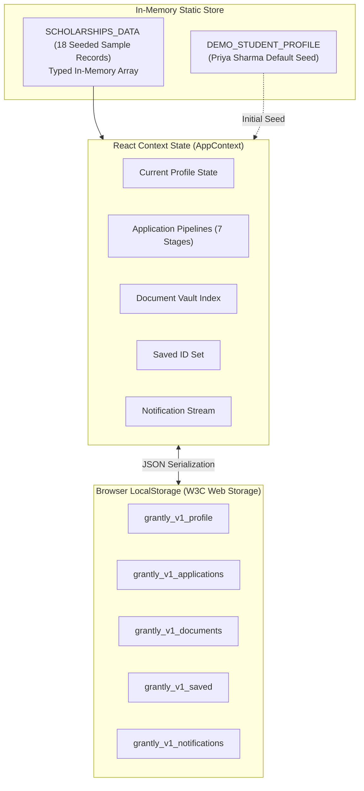
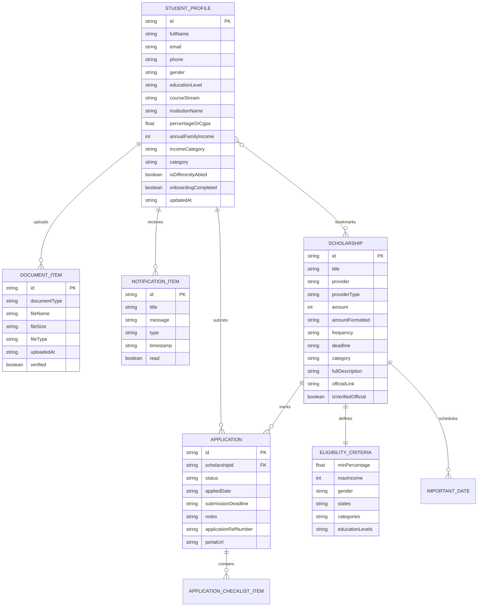
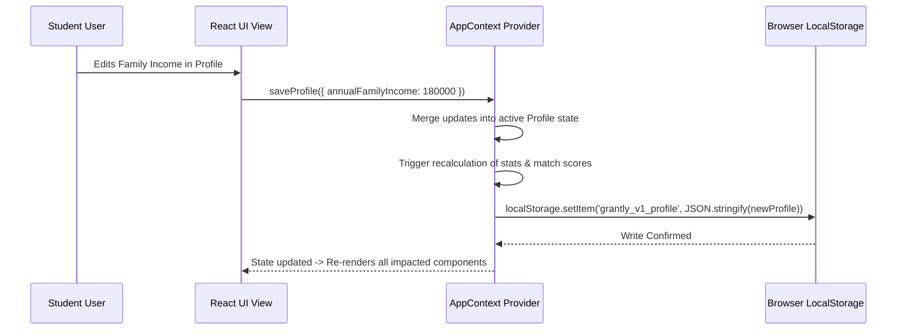

# GRANTLY — Database & Data Architecture Documentation

This document provides a technical specification of the data architecture, entity models, schema definitions, validation rules, and persistence mechanisms of **GRANTLY – Unified Scholarship Discovery & Management Platform**.

---

## 📋 Table of Contents

- [1. Data Architecture Overview](#1-data-architecture-overview)
- [2. Client-Side Persistence Layer (`LocalStorage`)](#2-client-side-persistence-layer-localstorage)
- [3. Entity-Relationship (ER) Diagram](#3-entity-relationship-er-diagram)
- [4. Data Models & Entity Dictionary](#4-data-models--entity-dictionary)
  - [4.1 `StudentProfile`](#41-studentprofile)
  - [4.2 `Scholarship`](#42-scholarship)
  - [4.3 `EligibilityCriteria`](#43-eligibilitycriteria)
  - [4.4 `ImportantDate`](#44-importantdate)
  - [4.5 `Application`](#45-application)
  - [4.6 `ApplicationChecklistItem`](#46-applicationchecklistitem)
  - [4.7 `DocumentItem`](#47-documentitem)
  - [4.8 `NotificationItem`](#48-notificationitem)
  - [4.9 `RuleEvaluation` & `EligibilityReport`](#49-ruleevaluation--eligibilityreport)
  - [4.10 `MatchScoreBreakdown`](#410-matchscorebreakdown)
  - [4.11 `ApplicationReadiness`](#411-applicationreadiness)
- [5. Data Storage & Retrieval Lifecycle](#5-data-storage--retrieval-lifecycle)
- [6. Validation Rules & Data Integrity](#6-validation-rules--data-integrity)
- [7. Enterprise Migration Blueprint (PostgreSQL / Prisma)](#7-enterprise-migration-blueprint-postgresql--prisma)

---

## 1. Data Architecture Overview

GRANTLY is currently a **browser-side prototype** with no database server or backend API:

- **Scholarship Repository**: 18 seeded scholarship records are loaded as a typed in-memory dataset in [`src/data/scholarships.ts`](file:///e:/grantly/src/data/scholarships.ts). Their currentness and provider accuracy are not independently verified by the application.
- **User & Transactional State**: All dynamic student data—including profile declarations, 7-stage application tracking, uploaded document metadata, saved bookmarks, and notifications—is managed via React Context and persisted in the browser's `LocalStorage`.
- **Storage Boundary**: No external SQL or NoSQL database server is queried by the application. Browser `localStorage` is user-editable and is not an authentication boundary or a secure place for sensitive identity records.



---

## 2. Client-Side Persistence Layer (`LocalStorage`)

All user state is keyed under the prefix `grantly_v1_` to avoid namespace collisions with other applications:

| Key Name | TypeScript Entity | Storage Type | Default Fallback Value |
| :--- | :--- | :--- | :--- |
| `grantly_v1_profile` | `StudentProfile` | JSON string | `DEMO_STUDENT_PROFILE` (Priya Sharma) |
| `grantly_v1_saved` | `string[]` | JSON string | `INITIAL_SAVED_IDS` (3 IDs) |
| `grantly_v1_apps` | `Application[]` | JSON string | `INITIAL_APPLICATIONS` (demo records) |
| `grantly_v1_docs` | `DocumentItem[]` | JSON string | `INITIAL_DOCUMENTS` (demo metadata records) |
| `grantly_v1_notifs` | `NotificationItem[]` | JSON string | `INITIAL_NOTIFICATIONS` (demo alerts) |
| `grantly_v1_auth` | `boolean` | Raw string (`"true"` / `"false"`) | `"true"` |

### Fault Tolerance & Hydration Guard

To keep the server and first client render consistent, the provider renders demo defaults and restores browser storage in an effect. JSON parsing errors fall back to demo values; stored object shapes are not fully schema-validated:

```typescript
const [profile, setProfile] = useState<StudentProfile | null>(() => {
  if (typeof window !== 'undefined') {
    try {
      const stored = localStorage.getItem(`${STORAGE_KEY_PREFIX}profile`);
      return stored ? JSON.parse(stored) : DEMO_STUDENT_PROFILE;
    } catch {
      return DEMO_STUDENT_PROFILE;
    }
  }
  return DEMO_STUDENT_PROFILE;
});
```

---

## 3. Entity-Relationship (ER) Diagram

The following Mermaid diagram depicts the logical relationships between entities across the system:



---

## 4. Data Models & Entity Dictionary

All entities are strictly defined in [`src/types/index.ts`](file:///e:/grantly/src/types/index.ts).

### 4.1 `StudentProfile`
Represents student-declared profile details used by the preliminary match and eligibility engines. Values are not independently verified.

| Field Name | Type | Nullable | Validation / Constraints | Description |
| :--- | :--- | :--- | :--- | :--- |
| `id` | `string` | No | Unique identifier (`student-*` or UUID) | Primary key for student. |
| `fullName` | `string` | No | Min 2 chars | Full legal name of student. |
| `email` | `string` | No | Standard email format | Student contact email. |
| `phone` | `string` | Yes | 10-digit Indian mobile | Optional mobile contact number. |
| `avatar` | `string` | Yes | URL | Profile avatar image link. |
| `state` | `string` | No | Valid Indian State/UT | State of permanent domicile. |
| `city` | `string` | No | Non-empty string | City or district of residence. |
| `dob` | `string` | Yes | ISO Date (`YYYY-MM-DD`) | Date of birth. |
| `gender` | `Gender` | No | `'male' \| 'female' \| 'other' \| 'prefer_not_to_say'` | Declared gender for quota benefits. |
| `educationLevel` | `EducationLevel` | No | 6 standardized tiers | Current active education stage. |
| `courseStream` | `string` | No | Non-empty string | Enrolled degree or specialization (e.g. B.Tech CSE). |
| `institutionName` | `string` | No | Non-empty string | College, University, or School name. |
| `currentAcademicYear`| `string` | No | e.g. "2nd Year", "Class 12" | Current study year. |
| `percentageOrCgpa` | `number` | No | `0 <= value <= 100` | Aggregate marks in qualifying exam. |
| `annualFamilyIncome` | `number` | No | Positive integer in INR | Annual household gross income. |
| `incomeCategory` | `IncomeCategory` | No | 5 income bands | Income classification bracket. |
| `category` | `SocialCategory` | No | `'General' \| 'OBC' \| 'SC' \| 'ST' \| 'EWS' \| 'Minority'` | Reservation or affirmative action tier. |
| `isDifferentlyAbled` | `boolean` | No | Default `false` | PwD reservation eligibility flag. |
| `preferredScholarshipCategories` | `string[]` | No | Array of category strings | Focus categories (STEM, Women, Need). |
| `preferredStudyLevel` | `string[]` | No | Array of level strings | Target study levels. |
| `preferredLocation` | `string` | No | e.g. "All India" | Location preference. |
| `scholarshipTypePreference` | `string` | No | `'All' \| 'Government Only' \| 'Private Only'` | Provider preference filter. |
| `onboardingCompleted` | `boolean` | No | Boolean flag | Gates access to automated matching. |
| `updatedAt` | `string` | No | ISO 8601 Timestamp | Last update timestamp. |

### 4.2 `Scholarship`
Represents an official academic funding program.

| Field Name | Type | Nullable | Constraints / Description |
| :--- | :--- | :--- | :--- |
| `id` | `string` | No | Slug identifier (e.g. `'reliance-foundation-ug-2026'`). |
| `title` | `string` | No | Official name of the scholarship scheme. |
| `provider` | `string` | No | Issuing organization (e.g. "Reliance Foundation", "AICTE"). |
| `providerType` | `ProviderType` | No | `'Government' \| 'Private' \| 'Trust / NGO' \| 'Corporate CSR'`. |
| `providerLogo` | `string` | Yes | Optional logo image URL. |
| `amount` | `number` | No | Numeric award value in INR (e.g. `200000`). |
| `amountFormatted` | `string` | No | Formatted label (e.g. `"Up to ₹2,00,000"`). |
| `frequency` | `string` | No | `'One-Time' \| 'Annual' \| 'Semester-wise' \| 'Full Course Fee'`. |
| `deadline` | `string` | No | ISO Date string (`YYYY-MM-DD`). |
| `category` | `ScholarshipCategory`| No | Primary domain (`'Merit-Based' \| 'STEM & Tech' \| ...`). |
| `educationLevels` | `EducationLevel[]` | No | Applicable education levels. |
| `courses` | `string[]` | No | Eligible courses or streams. |
| `shortDescription` | `string` | No | 1-2 sentence preview summary. |
| `fullDescription` | `string` | No | Comprehensive program description and mission. |
| `coverage` | `string` | No | What expenses are covered (Tuition, Laptop, Hostels). |
| `eligibilityCriteria`| `EligibilityCriteria`| No | Structured multi-condition rule definition. |
| `academicRequirements` | `string[]` | No | Array of academic guideline bullets. |
| `incomeRequirements` | `string` | No | Plain-text explanation of income rules. |
| `requiredDocuments` | `string[]` | No | Array of document types mandatory for submission. |
| `applicationProcedure` | `string[]` | No | Step-by-step instructions for applying. |
| `importantDates` | `ImportantDate[]` | No | Array of timeline milestone events. |
| `officialLink` | `string` | Yes | External application portal URL. |
| `isVerifiedOfficial` | `boolean` | No | Seed-data flag; the application does not independently validate this claim. |
| `tags` | `string[]` | No | Search and classification tags. |
| `featured` | `boolean` | Yes | Flag for hero / carousel placement. |
| `applicantCount` | `number` | Yes | Illustrative competition volume metric. |

### 4.3 `EligibilityCriteria`
Embedded structure defining the qualification rules for a scholarship.

```typescript
export interface EligibilityCriteria {
  minPercentage?: number;            // e.g. 60 (Minimum marks %)
  maxIncome?: number;                // e.g. 250000 (Max annual family income in INR)
  gender?: 'Any' | 'female' | 'male';// Specific gender target
  states?: string[];                 // ['All India'] or ['Maharashtra', 'Delhi']
  categories?: SocialCategory[];     // ['General', 'OBC', 'SC', 'ST', 'EWS', 'Minority']
  educationLevels?: EducationLevel[];// Permitted education tiers
  coursesAllowed?: string[];         // Permitted course streams
  isDifferentlyAbledOnly?: boolean;  // PwD mandatory flag
  minAge?: number;                   // Optional lower age boundary
  maxAge?: number;                   // Optional upper age boundary
}
```

### 4.4 `ImportantDate`
Timeline event associated with a scholarship.

```typescript
export interface ImportantDate {
  label: string;    // e.g. "Application Window Opens", "Final Submission Deadline"
  date: string;     // e.g. "25 Nov 2026"
  isPassed?: boolean;
}
```

### 4.5 `Application`
Represents an instance of a student applying for a specific scholarship.

| Field Name | Type | Description |
| :--- | :--- | :--- |
| `id` | `string` | Primary key (`app-*` or UUID). |
| `scholarshipId` | `string` | Foreign key referencing `Scholarship.id`. |
| `scholarship` | `Scholarship` | Denormalized scholarship object for zero-join rendering. |
| `status` | `ApplicationStatus`| `'Saved' \| 'Planning to Apply' \| 'Applied' \| 'Under Review' \| 'Shortlisted' \| 'Approved' \| 'Rejected'`. |
| `appliedDate` | `string` (Optional) | ISO date when application was submitted. |
| `submissionDeadline` | `string` | Deadline timestamp. |
| `updatedDate` | `string` | ISO timestamp of last stage movement. |
| `notes` | `string` (Optional) | Student's personal notes regarding application. |
| `applicationRefNumber`| `string` (Optional) | Official application portal confirmation ID. |
| `checklist` | `ApplicationChecklistItem[]` | Progress sub-tasks. |
| `portalUrl` | `string` (Optional) | Direct submission link. |

### 4.6 `DocumentItem`
Represents a certificate or credential uploaded to the student's Document Vault.

| Field Name | Type | Description |
| :--- | :--- | :--- |
| `id` | `string` | Unique document record ID (`doc-*`). |
| `documentType` | `string` (Union) | `'Aadhaar Card' \| 'Income Certificate' \| 'Caste Certificate' \| 'Domicile Certificate' \| 'Previous Academic Marksheet' \| 'Bonafide Certificate' \| 'Bank Passbook' \| 'Passport-size Photograph' \| 'Statement of Purpose / Essay'`. |
| `fileName` | `string` | File name (e.g. `"Tahsildar_Income_Cert_FY26.pdf"`). |
| `fileSize` | `string` | Human-readable size (e.g. `"850 KB"`). |
| `fileType` | `string` | MIME type (e.g. `"application/pdf"`). |
| `uploadedAt` | `string` | ISO upload timestamp. |
| `verified` | `boolean` | Verification state in the record. New document metadata records start as unverified; no certificate verification service exists. |
| `notes` | `string` (Optional) | Issuing authority or expiry details. |

### 4.7 `NotificationItem`
System or deadline notification delivered to the student.

| Field Name | Type | Description |
| :--- | :--- | :--- |
| `id` | `string` | Unique notification ID (`notif-*`). |
| `title` | `string` | Short notification title. |
| `message` | `string` | Detailed message content. |
| `type` | `string` (Union) | `'deadline' \| 'status_change' \| 'profile' \| 'document' \| 'recommendation'`. |
| `timestamp` | `string` | ISO timestamp. |
| `read` | `boolean` | Read / unread status flag. |
| `link` | `string` (Optional) | Destination URL when clicked. |
| `scholarshipId` | `string` (Optional) | Associated scholarship reference. |

---

## 5. Data Storage & Retrieval Lifecycle



---

## 6. Validation Rules & Data Integrity

1. **Academic Percentage / CGPA**:
   - Must be between `0` and `100`.
   - In profile inputs, CGPA is automatically converted to percentage via the standard formula: $\text{Percentage} = \text{CGPA} \times 9.5$.
2. **Annual Family Income**:
   - Non-negative integer.
   - Automatically synchronizes with the `incomeCategory` band (e.g., `< ₹1,50,000` maps to `'Below ₹1.5 Lakh'`).
3. **Application Stage Progression**:
   - Must follow valid transitions between the 7 lifecycle states.
   - Stage transitions automatically set `updatedDate = new Date().toISOString()`.
4. **Comparison Maximum**:
   - The comparison set enforces a strict maximum of **3 scholarships**. Attempting to add a 4th prompts the user to deselect an existing scheme.

---

## 7. Enterprise Migration Blueprint (PostgreSQL / Prisma)

When migrating GRANTLY to an enterprise multi-tenant cloud backend, the existing TypeScript models map directly to relational tables. Below is the proposed production **Prisma Schema**:

```prisma
datasource db {
  provider = "postgresql"
  url      = env("DATABASE_URL")
}

generator client {
  provider = "prisma-client-js"
}

enum EducationLevel {
  SCHOOL_9_10
  HIGHER_SECONDARY_11_12
  UNDERGRADUATE
  POSTGRADUATE
  PHD_RESEARCH
  DIPLOMA_VOCATIONAL
}

enum Gender {
  MALE
  FEMALE
  OTHER
  PREFER_NOT_TO_SAY
}

enum SocialCategory {
  GENERAL
  OBC
  SC
  ST
  EWS
  MINORITY
}

enum ApplicationStatus {
  SAVED
  PLANNING_TO_APPLY
  APPLIED
  UNDER_REVIEW
  SHORTLISTED
  APPROVED
  REJECTED
}

model StudentProfile {
  id                   String           @id @default(uuid())
  userId               String           @unique
  fullName             String
  email                String           @unique
  phone                String?
  avatarUrl            String?
  state                String
  city                 String
  dob                  DateTime?
  gender               Gender
  educationLevel       EducationLevel
  courseStream         String
  institutionName      String
  percentageOrCgpa     Decimal          @db.Decimal(5, 2)
  annualFamilyIncome   Decimal          @db.Decimal(12, 2)
  category             SocialCategory
  isDifferentlyAbled   Boolean          @default(false)
  onboardingCompleted  Boolean          @default(false)
  createdAt            DateTime         @default(now())
  updatedAt            DateTime         @updatedAt

  applications         Application[]
  documents            DocumentItem[]
  savedScholarships    SavedScholarship[]
}

model Scholarship {
  id                   String           @id
  title                String
  provider             String
  providerType         String
  amount               Decimal          @db.Decimal(12, 2)
  amountFormatted      String
  frequency            String
  deadline             DateTime
  category             String
  fullDescription      String           @db.Text
  officialLink         String?
  isVerifiedOfficial   Boolean          @default(true)
  
  // JSON field for flexible criteria or dedicated relation
  criteria             Json
  requiredDocuments    String[]

  applications         Application[]
  savedBy              SavedScholarship[]
}

model Application {
  id                   String             @id @default(uuid())
  studentId            String
  scholarshipId        String
  status               ApplicationStatus  @default(SAVED)
  appliedDate          DateTime?
  submissionDeadline   DateTime
  notes                String?            @db.Text
  applicationRefNumber String?
  portalUrl            String?
  createdAt            DateTime           @default(now())
  updatedAt            DateTime           @updatedAt

  student              StudentProfile     @relation(fields: [studentId], references: [id], onDelete: Cascade)
  scholarship          Scholarship        @relation(fields: [scholarshipId], references: [id], onDelete: Cascade)

  @@unique([studentId, scholarshipId])
}

model DocumentItem {
  id                   String           @id @default(uuid())
  studentId            String
  documentType         String
  fileName             String
  fileSize             String
  fileUrl              String           // S3 / Cloud Storage URL
  verified             Boolean          @default(false)
  uploadedAt           DateTime         @default(now())

  student              StudentProfile   @relation(fields: [studentId], references: [id], onDelete: Cascade)
}

model SavedScholarship {
  studentId            String
  scholarshipId        String
  savedAt              DateTime         @default(now())

  student              StudentProfile   @relation(fields: [studentId], references: [id], onDelete: Cascade)
  scholarship          Scholarship      @relation(fields: [scholarshipId], references: [id], onDelete: Cascade)

  @@id([studentId, scholarshipId])
}
```

