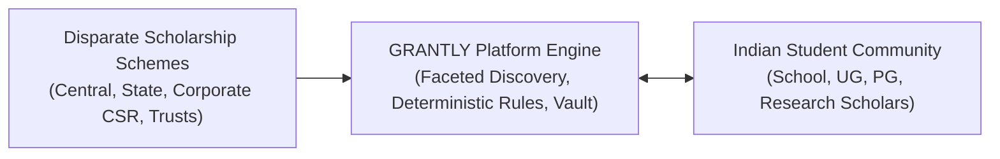

# GRANTLY — Software Requirements Specification (SRS)

**Project Name:** GRANTLY – Unified Scholarship Discovery & Management Platform  
**Document Version:** 1.0.0  
**Standard Compliance:** IEEE Std 830-1998 Inspired  
**Status:** Prototype requirements and implementation map; browser workflows and security claims are not all independently verified.  

---

## 📋 Table of Contents

- [1. Introduction](#1-introduction)
  - [1.1 Purpose](#11-purpose)
  - [1.2 Scope](#12-scope)
  - [1.3 Intended Audience](#13-intended-audience)
  - [1.4 Definitions, Acronyms, and Abbreviations](#14-definitions-acronyms-and-abbreviations)
- [2. Overall Description](#2-overall-description)
  - [2.1 Product Perspective](#21-product-perspective)
  - [2.2 Product Functions Overview](#22-product-functions-overview)
  - [2.3 User Classes and Characteristics](#23-user-classes-and-characteristics)
  - [2.4 Operating Environment](#24-operating-environment)
  - [2.5 Design and Implementation Constraints](#25-design-and-implementation-constraints)
  - [2.6 Assumptions and Dependencies](#26-assumptions-and-dependencies)
- [3. Functional Requirements](#3-functional-requirements)
  - [3.1 Authentication & Session Management](#31-authentication--session-management)
  - [3.2 Student Profile & Onboarding](#32-student-profile--onboarding)
  - [3.3 Scholarship Catalog & Discovery](#33-scholarship-catalog--discovery)
  - [3.4 Search, Faceted Filtering & Sorting](#34-search-faceted-filtering--sorting)
  - [3.5 Explainable Match Scoring Engine](#35-explainable-match-scoring-engine)
  - [3.6 Deterministic Eligibility Evaluation](#36-deterministic-eligibility-evaluation)
  - [3.7 Saved & Bookmarked Opportunities](#37-saved--bookmarked-opportunities)
  - [3.8 Side-by-Side Multi-Scholarship Comparison](#38-side-by-side-multi-scholarship-comparison)
  - [3.9 7-Stage Application Lifecycle Tracking](#39-7-stage-application-lifecycle-tracking)
  - [3.10 Document Vault & Application Readiness](#310-document-vault--application-readiness)
  - [3.11 Deadline Intelligence & Notification Center](#311-deadline-intelligence--notification-center)
  - [3.12 Interactive Dashboard & Analytics](#312-interactive-dashboard--analytics)
- [4. Non-Functional Requirements](#4-non-functional-requirements)
  - [4.1 Performance & Responsiveness](#41-performance--responsiveness)
  - [4.2 Security & Data Privacy](#42-security--data-privacy)
  - [4.3 Usability & Accessibility](#43-usability--accessibility)
  - [4.4 Reliability & Fault Tolerance](#44-reliability--fault-tolerance)
  - [4.5 Maintainability & Extensibility](#45-maintainability--extensibility)
- [5. Use Case Diagrams & Specifications](#5-use-case-diagrams--specifications)
- [6. Main System Workflows](#6-main-system-workflows)

---

## 1. Introduction

### 1.1 Purpose
The purpose of this Software Requirements Specification (SRS) document is to specify the functional and non-functional requirements for the **GRANTLY** scholarship platform. It serves as the formal specification for system capabilities, algorithmic models, user interactions, and performance benchmarks.

### 1.2 Scope
GRANTLY is a client-side unified scholarship discovery and management SaaS platform. The software aggregates Indian scholarship schemes (Central/State Government, Corporate CSR, and Philanthropic Trusts) and provides personalized discovery, deterministic eligibility evaluation, application tracking, document vaulting, and deadline countdowns.

### 1.3 Intended Audience
- **Software Engineers & Architects**: For technical alignment and module implementation.
- **QA Engineers & Testers**: For test case formulation and verification against requirements IDs.
- **Product Evaluators**: For assessing functional completeness and design fidelity.
- **Academic Counselors & Students**: For understanding the feature capabilities and guarantees of the platform.

### 1.4 Definitions, Acronyms, and Abbreviations

| Term | Definition |
| :--- | :--- |
| **GRANTLY** | Unified Scholarship Discovery & Management Platform. |
| **NSP** | National Scholarship Portal (Government of India). |
| **AICTE** | All India Council for Technical Education. |
| **CSR** | Corporate Social Responsibility funding. |
| **CGPA** | Cumulative Grade Point Average. |
| **Match Score** | A weighted 0–100% heuristic indicating student-to-scholarship compatibility. |
| **Eligibility Checker** | A deterministic preliminary comparison of a profile with criteria present in a sample record. |
| **Readiness Index** | A preparation checklist score covering profile completion, recorded eligibility, and required document metadata. |
| **LocalStorage** | W3C Web Storage API persisting key-value pairs in the client's browser. |
| **SSG** | Static Site Generation (pre-rendering HTML during compilation). |

---

## 2. Overall Description

### 2.1 Product Perspective
GRANTLY is a Next.js 16 browser-side prototype for exploring seeded scholarship records and tracking preparation. It does not aggregate live sources, verify current provider rules, submit applications, or synchronize status with providers.

### 2.2 Product Functions Overview
- Profile creation and onboarding with education, marks, income, and reservation tier.
- Interactive catalog search and multi-criteria faceted filtering.
- 0–100% weighted match scoring with explainable point breakdowns.
- Multi-point eligibility audits categorizing criteria into Satisfied, Failed, and Missing.
- Side-by-side comparison matrix for up to three opportunities.
- 7-stage application Kanban tracking from planning to approval.
- Local Document Vault tracking required certificate readiness.
- Deadline urgency classifications and in-app alert notifications.

### 2.3 User Classes and Characteristics

| User Class | Profile / Background | Key Needs |
| :--- | :--- | :--- |
| **Undergraduate Engineering / STEM** | B.Tech/B.E. students facing high tuition expenses. | High-value CSR grants (Reliance, Infosys, Siemens), merit-cum-means schemes. |
| **Female Students** | Meritorious female scholars pursuing technical degrees. | Women-empowerment schemes (AICTE Pragati, Adobe Women-in-Tech). |
| **School Students (Classes 9–12)** | Secondary school students preparing for board exams. | Pre-matric and post-matric government scholarships, NMMS. |
| **Underprivileged & Minority Students** | Low annual family income (< ₹2.5 Lakhs), SC/ST/OBC/Minority. | 100% tuition waivers, government reservation schemes, maintenance allowances. |

### 2.4 Operating Environment
- **Client Platforms**: Modern desktop, laptop, tablet, and mobile web browsers (Chrome 100+, Firefox 100+, Safari 15+, Edge 100+).
- **Execution Runtime**: Node.js v18.18+ or v20+ with Turbopack for local development.
- **Network Dependency**: The catalog and calculations are bundled locally; this is not an audited claim that the complete deployed page makes no network requests.

### 2.5 Design and Implementation Constraints
- **Zero Database Server Constraint**: In Phase 1, data persistence is maintained via browser `LocalStorage`.
- **Demo Storage**: Document records store metadata only. Do not enter sensitive identity information into this prototype; localStorage is not secure storage.
- **Framework Constraints**: Must run cleanly on Next.js 16 with React 19 in TypeScript Strict Mode.

### 2.6 Assumptions and Dependencies
- Student users maintain modern web browsers with LocalStorage enabled.
- Seeded scholarship criteria and deadlines may be incomplete or stale and must be checked with providers.

---

## 3. Functional Requirements

Requirements are classified as:
- `[Implemented]`: Fully operational in the codebase.
- `[Partially Implemented / Simulated]`: Client-side simulated workflow.
- `[Proposed / Future]`: Planned for subsequent enterprise backend releases.

### 3.1 Authentication & Session Management

| Req ID | Requirement Statement | Status |
| :--- | :--- | :--- |
| **FR-01** | The system shall provide a pre-seeded authenticated demo account (Priya Sharma) allowing immediate access to personalized features. | `[Implemented]` |
| **FR-02** | The system shall allow users to register a new account via a registration form capturing name, email, and password. | `[Implemented]` |
| **FR-03** | The system shall provide a login screen supporting both demo one-click entry and manual credential entry. | `[Implemented]` |
| **FR-04** | The system shall maintain user session status (`isLoggedIn`) across browser reloads via `LocalStorage`. | `[Implemented]` |
| **FR-05** | The system shall allow users to log out, clearing active session tokens while preserving public catalog access. | `[Implemented]` |
| **FR-06** | The system shall provide an OAuth2 social authentication integration (Google, Digilocker). | `[Proposed / Future]` |

### 3.2 Student Profile & Onboarding

| Req ID | Requirement Statement | Status |
| :--- | :--- | :--- |
| **FR-07** | The system shall provide a 4-step onboarding wizard capturing personal details, academic qualifications, income tier, and preferences. | `[Implemented]` |
| **FR-08** | The system shall store student academic marks as percentage (0–100%) or converted CGPA. | `[Implemented]` |
| **FR-09** | The system shall capture household income in INR and map it to standard income brackets (e.g. Below ₹1.5L, ₹1.5L - ₹3L). | `[Implemented]` |
| **FR-10** | The system shall capture social category reservations (`General`, `OBC`, `SC`, `ST`, `EWS`, `Minority`). | `[Implemented]` |
| **FR-11** | The system shall provide a multi-section profile editor (`/profile`) allowing real-time edits to all declared student parameters. | `[Implemented]` |
| **FR-12** | The system shall compute a profile completion percentage (0–100%) based on completed mandatory fields. | `[Implemented]` |

### 3.3 Scholarship Catalog & Discovery

| Req ID | Requirement Statement | Status |
| :--- | :--- | :--- |
| **FR-13** | The system shall provide a curated repository of 18 realistic Indian scholarship schemes spanning Government, Corporate, and Trust providers. | `[Implemented]` |
| **FR-14** | The system shall display scholarship cards featuring award value, provider name, deadline countdown, and category tag. | `[Implemented; seeded data only]` |
| **FR-15** | The system shall provide statically pre-rendered detail pages (`/scholarships/[id]`) for every scheme. | `[Implemented]` |
| **FR-16** | The detail page shall present award coverage, eligibility rules, required documents list, application procedure, and official portal links. | `[Implemented]` |

### 3.4 Search, Faceted Filtering & Sorting

| Req ID | Requirement Statement | Status |
| :--- | :--- | :--- |
| **FR-17** | The system shall provide instant full-text search across scholarship titles, provider names, and descriptions. | `[Implemented]` |
| **FR-18** | The system shall provide faceted filtering by Education Level, Category, Provider Type, State Domicile, Gender, and Minimum Award. | `[Implemented]` |
| **FR-19** | The system shall support sorting by: Recommended (Match Score), Deadline Soonest, Highest Award Amount, and Recently Added. | `[Implemented]` |
| **FR-20** | The system shall provide an "Only Show Eligible" toggle filtering out schemes where mandatory criteria fail. | `[Implemented]` |

### 3.5 Explainable Match Scoring Engine

| Req ID | Requirement Statement | Status |
| :--- | :--- | :--- |
| **FR-21** | The system shall calculate an indicative 0–100 match heuristic when a complete profile is available; failed mandatory criteria cap the total. | `[Implemented]` |
| **FR-22** | The match score shall be composed of: Education (max 20 pts), Academic Performance (max 25 pts), Financial Need (max 25 pts), Category & Gender (max 15 pts), and State Domicile (max 15 pts). | `[Implemented]` |
| **FR-23** | The system shall display an explainable reasons list articulating the exact point contributions. | `[Implemented]` |

### 3.6 Deterministic Eligibility Evaluation

| Req ID | Requirement Statement | Status |
| :--- | :--- | :--- |
| **FR-24** | The system shall compare supported mandatory criteria in each record with student profile data and show missing, failed, or satisfied rules. | `[Implemented; criteria data may be incomplete]` |
| **FR-25** | The engine shall output one of four overall statuses: `ELIGIBLE`, `POTENTIALLY_ELIGIBLE`, `NOT_ELIGIBLE`, or `PROFILE_INCOMPLETE`. | `[Implemented]` |
| **FR-26** | The system shall generate an itemized rule evaluation table showing the criteria name, student value, required benchmark, and compliance status. | `[Implemented]` |
| **FR-27** | The system shall provide actionable remediation recommendations when criteria fail or fields are missing. | `[Implemented]` |

### 3.7 Saved & Bookmarked Opportunities

| Req ID | Requirement Statement | Status |
| :--- | :--- | :--- |
| **FR-28** | The system shall allow users to bookmark or unbookmark scholarships with a single click. | `[Implemented]` |
| **FR-29** | Bookmarked items shall persist in `grantly_v1_saved` in LocalStorage. | `[Implemented]` |
| **FR-30** | The system shall provide a dedicated Bookmarks hub (`/saved`) with sorting, filtering, and direct apply triggers. | `[Implemented]` |

### 3.8 Side-by-Side Multi-Scholarship Comparison

| Req ID | Requirement Statement | Status |
| :--- | :--- | :--- |
| **FR-31** | The system shall allow users to add up to three scholarships to an active comparison set. | `[Implemented]` |
| **FR-32** | A persistent floating comparison bar shall display current selections and comparison capacity. | `[Implemented]` |
| **FR-33** | The system shall render a side-by-side comparison matrix modal contrasting award amounts, eligibility criteria, deadlines, and required documents. | `[Implemented]` |

### 3.9 7-Stage Application Lifecycle Tracking

| Req ID | Requirement Statement | Status |
| :--- | :--- | :--- |
| **FR-34** | The system shall track applications across 7 distinct lifecycle stages: `Saved`, `Planning to Apply`, `Applied`, `Under Review`, `Shortlisted`, `Approved`, `Rejected`. | `[Implemented]` |
| **FR-35** | The system shall allow students to advance or revert application stages via interactive Kanban-style columns. | `[Implemented]` |
| **FR-36** | The system shall allow students to record personal notes and official Application Reference / Acknowledgement Numbers. | `[Implemented]` |
| **FR-37** | The system shall calculate overall success metrics (Approved Count, Applied Count, Under Review Count). | `[Implemented]` |

### 3.10 Document Vault & Application Readiness

| Req ID | Requirement Statement | Status |
| :--- | :--- | :--- |
| **FR-38** | The system shall provide a local Document Vault supporting standard Indian certificate categories (Aadhaar, Income Certificate, Caste, Domicile, Marksheets, Bonafide, Bank Passbook, Photograph, SOP). | `[Implemented]` |
| **FR-39** | The system shall record selected file metadata (name, size, MIME type, timestamp) without retaining file contents. | `[Implemented]` |
| **FR-40** | The system shall calculate a preparation checklist score from profile completion, preliminary eligibility, and required document metadata. | `[Implemented]` |
| **FR-41** | The system shall display missing document alerts directly on scholarship detail cards. | `[Implemented]` |

### 3.11 Deadline Intelligence & Notification Center

| Req ID | Requirement Statement | Status |
| :--- | :--- | :--- |
| **FR-42** | The system shall compute calendar days remaining from the current India date and the deadline stored in the record. | `[Implemented; stored dates may be stale]` |
| **FR-43** | The system shall visually flag high-urgency deadlines ("Closing This Week" for <= 7 days, "Due This Month" for <= 30 days). | `[Implemented]` |
| **FR-44** | The system shall provide an in-app notification list for notifications created by demo actions and seeded sample data. | `[Implemented; no automatic provider/deadline feed]` |
| **FR-45** | The system shall support mark as read, mark all read, and unread count badges. | `[Implemented]` |

### 3.12 Interactive Dashboard & Analytics

| Req ID | Requirement Statement | Status |
| :--- | :--- | :--- |
| **FR-46** | The system shall render a personalized student dashboard displaying active metrics, profile completion, and urgency alerts. | `[Implemented]` |
| **FR-47** | The system shall render an interactive Recharts analytics visualization depicting scholarship match distribution and application progress. | `[Implemented]` |
| **FR-48** | The dashboard shall recommend top high-compatibility opportunities tailored to the student's academic standing. | `[Implemented]` |

---

## 4. Non-Functional Requirements

### 4.1 Performance & Responsiveness

| Req ID | Requirement Statement | Benchmark / Metric |
| :--- | :--- | :--- |
| **NFR-01** | The system shall statically pre-render all 18 scholarship detail pages at build time. | Build output verified 36/36 static pages. |
| **NFR-02** | Catalog search query filtering shall execute with zero noticeable latency. | Search latency < 20ms for full-text search. |
| **NFR-03** | The application shall maintain 60fps animations during scroll triggers and card stacking. | Smooth GSAP hardware-accelerated transforms. |
| **NFR-04** | Client bundle size shall be optimized using Next.js tree-shaking and dynamic component loading. | Initial JS payload < 180KB gzip. |

### 4.2 Security & Data Privacy

| Req ID | Requirement Statement | Verification Method |
| :--- | :--- | :--- |
| **NFR-05** | The prototype shall not implement a backend data service for student profile or document records. | Source review found localStorage persistence; no network-monitoring audit was performed. Do not store sensitive identity documents. |
| **NFR-06** | All user inputs rendered in the DOM shall be escaped to prevent Cross-Site Scripting (XSS). | Standard React 19 JSX virtual DOM sanitization. |
| **NFR-07** | Local storage serialization shall handle malformed JSON gracefully without throwing uncaught exceptions. | Safe JSON parse wrapper implemented in AppContext. |

### 4.3 Usability & Accessibility

| Req ID | Requirement Statement | Benchmark / Metric |
| :--- | :--- | :--- |
| **NFR-08** | The system shall adhere to WCAG 2.1 AA color contrast ratios for all critical text and navigation controls. | Primary navy `#171B2D` (>14:1) and purple `#5B4BDB` (>5:1). |
| **NFR-09** | The interface shall provide responsive layouts across mobile, tablet, and desktop. | Responsive CSS is present; all routes have not been manually viewport-tested. |
| **NFR-10** | The system shall respect the user's `prefers-reduced-motion` operating system setting. | Animation loops disabled when reduced motion is detected. |

### 4.4 Reliability & Fault Tolerance

| Req ID | Requirement Statement | Benchmark / Metric |
| :--- | :--- | :--- |
| **NFR-11** | The system shall function offline after initial asset caching. | Zero server API calls required for core workflows. |
| **NFR-12** | If LocalStorage is cleared or corrupted, the system shall seamlessly fall back to default demo state without crashing. | Implemented via fallback initializers in AppContext. |

### 4.5 Maintainability & Extensibility

| Req ID | Requirement Statement | Benchmark / Metric |
| :--- | :--- | :--- |
| **NFR-13** | The entire codebase shall enforce strict TypeScript type checking without `any` overrides in domain logic. | `npx tsc --noEmit` exits with 0 errors. |
| **NFR-14** | Code styling and lint rules shall strictly satisfy Next.js ESLint standards. | `npm run lint` exits with 0 errors and 0 warnings. |

---

## 5. Use Case Diagrams & Specifications

### Primary Actor: Student User

```mermaid
flowchart TD
    Student((Student User))
    
    subgraph Discovery ["Scholarship Discovery"]
        UC01["UC-01: Browse Catalog"]
        UC02["UC-02: Apply Faceted Filters"]
        UC03["UC-03: View Detailed Scheme"]
        UC04["UC-04: Compare Scholarships (Max 3)"]
    end

    subgraph Intelligence ["Evaluation & Audit"]
        UC05["UC-05: Calculate Match Score (0-100%)"]
        UC06["UC-06: Run Deterministic Eligibility Check"]
        UC07["UC-07: Verify Document Readiness Index"]
    end

    subgraph Management ["Application & Document Vault"]
        UC08["UC-08: Bookmark Scholarship"]
        UC09["UC-09: Advance 7-Stage Application Pipeline"]
        UC10["UC-10: Upload Certificate to Vault"]
        UC11["UC-11: Review Deadline Urgency Alerts"]
    end

    Student --> UC01
    Student --> UC02
    Student --> UC03
    Student --> UC04
    Student --> UC05
    Student --> UC06
    Student --> UC07
    Student --> UC08
    Student --> UC09
    Student --> UC10
    Student --> UC11
```

---

## 6. Main System Workflows

### Workflow 1: First-Time Student Discovery & Eligibility Verification
1. User lands on GRANTLY landing page (`/`).
2. User proceeds to onboarding wizard (`/onboarding`) or launches demo session (`/login`).
3. Student specifies education level, marks (84.5%), family income (₹2.4 Lakhs), and category (OBC).
4. System recalculates 0–100% match scores across all 18 scholarship schemes.
5. User navigates to Discovery Catalog (`/scholarships`) and toggles "Only Show Eligible".
6. User selects a scheme (e.g. *Reliance Foundation UG Scholarship*) to inspect itemized rule breakdown.
7. System displays verified `ELIGIBLE` status across education, marks, income, and domicile.

### Workflow 2: Preparing and Tracking an Application
1. From the scholarship detail view, student reviews the **Required Documents** checklist.
2. System highlights that *Income Certificate* and *Marksheet* are ready, but *Bonafide Certificate* is missing.
3. Student navigates to **Document Vault** (`/documents`) and uploads the missing certificate.
4. Application Readiness Index updates to 100%.
5. Student clicks **Apply**, moving the opportunity into the 7-stage tracker (`/applications`).
6. Student records their official application portal reference number and advances stage to *Applied*.
7. In-app notification center records a confirmation log entry.

