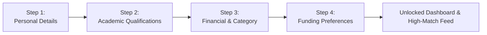

# GRANTLY — Student User Guide

Welcome to the **GRANTLY Student User Guide**.

This guide is designed to help Indian students navigate, discover, evaluate, and track scholarships effortlessly using GRANTLY. Follow the numbered steps below to unlock your maximum scholarship potential.

---

## 📋 Table of Contents

- [1. Getting Started & Logging In](#1-getting-started--logging-in)
- [2. Completing Student Onboarding](#2-completing-student-onboarding)
- [3. Navigating the Student Dashboard](#3-navigating-the-student-dashboard)
- [4. Discovering Scholarships (Search & Filters)](#4-discovering-scholarships-search--filters)
- [5. Understanding Your Match Score (0–100%)](#5-understanding-your-match-score-0100)
- [6. Auditing Eligibility (Rule Breakdown)](#6-auditing-eligibility-rule-breakdown)
- [7. Comparing Scholarships Side-by-Side](#7-comparing-scholarships-side-by-side)
- [8. Saving & Bookmarking Opportunities](#8-saving--bookmarking-opportunities)
- [9. Tracking Applications (7-Stage Pipeline)](#9-tracking-applications-7-stage-pipeline)
- [10. Managing Documents (Document Vault)](#10-managing-documents-document-vault)
- [11. In-App Notifications & Deadline Alerts](#11-in-app-notifications--deadline-alerts)
- [12. Managing Profile & System Settings](#12-managing-profile--system-settings)
- [13. Frequently Asked Questions (FAQ)](#13-frequently-asked-questions-faq)

---

## 1. Getting Started & Logging In

GRANTLY comes pre-configured with a **one-click demo student profile** (**Priya Sharma**, B.Tech student in Pune), allowing you to experience all features immediately.

### Option A: Quick One-Click Demo Access
1. Open your browser and navigate to `http://localhost:3000/login`.
2. Locate the purple banner labeled **One-Click Demo Access**.
3. Click **Continue as Priya Sharma (Demo Student)**.
4. You will immediately be redirected to your personalized **Dashboard** with real-time data populated.

> 📷 **Screenshot Placeholder**: *Login screen showing the "One-Click Demo Access" banner with pre-filled demo student credentials and the standard login form.*

### Option B: Creating a Custom Student Account
1. Navigate to `/signup`.
2. Enter your **Full Name**, **Email Address**, and choose a **Password**.
3. Click **Create Account**.
4. You will automatically be transitioned into the **4-Step Onboarding Wizard**.

---

## 2. Completing Student Onboarding

Your student profile powers the **Smart Match Score** and **Deterministic Eligibility Checker**.



### Steps to Complete Onboarding:
1. **Step 1: Personal Details**:
   - Confirm your Full Name and Email.
   - Select your **Gender** (used to match women-specific grants like *AICTE Pragati*).
   - Select your **State of Domicile** (e.g. Maharashtra, Uttar Pradesh, Delhi) and City.
2. **Step 2: Academic Qualifications**:
   - Choose your current **Education Level** (e.g., *Undergraduate*, *Higher Secondary (11-12)*, *Postgraduate*).
   - Enter your **Course / Specialization** (e.g., *B.Tech Computer Science*).
   - Enter your **College / School Name** and current academic year.
   - Declare your **Percentage or CGPA** (e.g. `84.5%`).
3. **Step 3: Financial Standing & Social Category**:
   - Enter your **Annual Household Income** (e.g. `₹2,40,000`).
   - Select your matching **Income Category Bracket** (e.g. *₹1.5 Lakh - ₹3 Lakh*).
   - Select your **Social Reservation Category** (*General*, *OBC*, *SC*, *ST*, *EWS*, or *Minority*).
   - Toggle **Differently Abled (PwD)** if applicable.
4. **Step 4: Preferences & Completion**:
   - Select target domains (*STEM & Tech*, *Merit-Based*, *Women Empowerment*).
   - Click **Finish & Unlock Opportunities**. A celebratory confetti burst confirms onboarding completion!

> 📷 **Screenshot Placeholder**: *4-step onboarding wizard showing Step 3 with income bracket radio cards and social category selector.*

---

## 3. Navigating the Student Dashboard

The **Dashboard** (`/dashboard`) is your centralized command center:

```
+--------------------------------------------------------------------------------+
|  👋 Welcome back, Priya Sharma! [Profile: 100% Complete]                       |
+--------------------------------------------------------------------------------+
|  [ 4 Active Applications ]  [ 3 Saved Schemes ]  [ 80% Document Readiness ]    |
+--------------------------------------------------------------------------------+
|  📊 Application & Match Analytics Chart (Recharts)                             |
|     Visualizes your compatibility distribution across verified opportunities   |
+--------------------------------------------------------------------------------+
|  ⭐ Top Recommended Matches | ⏳ Urgency Countdown Alerts                       |
+--------------------------------------------------------------------------------+
```

1. **KPI Metric Cards**: Instantly view your active applications, saved schemes, document readiness score, and pending deadlines.
2. **Analytics Chart**: Visualizes your scholarship match spectrum and application status counts.
3. **Top Matches Feed**: Displays your highest-matching opportunities with single-click save and apply buttons.
4. **Deadline Radar**: Highlights schemes closing in fewer than 7 days in bold red alerts.

> 📷 **Screenshot Placeholder**: *Dashboard overview showing KPI metric cards at the top, analytics chart on the left, and urgent deadline alerts on the right.*

---

## 4. Discovering Scholarships (Search & Filters)

Navigate to **Scholarships** (`/scholarships`) to explore the curated directory of 18 official programs.

### Using Full-Text Search
- Type keywords such as `"Reliance"`, `"Girls"`, `"Engineering"`, or `"AICTE"` into the top search bar.
- The catalog filters results instantly as you type.

### Using Faceted Filters
On the left sidebar, narrow down your opportunities:
- **Education Level**: Filter by *School*, *Higher Secondary*, *Undergraduate*, etc.
- **Scholarship Category**: Select *STEM & Tech*, *Women Empowerment*, *Merit-Based*, *Need-Based*, etc.
- **Provider Type**: Contrast *Government Schemes* with *Corporate CSR* and *Trusts*.
- **State Domicile**: Show *All India* schemes or state-specific schemes (e.g. *Maharashtra*, *Uttar Pradesh*).
- **Minimum Award Amount**: Set a minimum funding slider (e.g. `₹50,000+`).
- **Only Eligible Toggle**: Check this box to instantly hide any scholarship where your profile does not satisfy mandatory criteria!

### Sorting Opportunities
Use the sort dropdown to order schemes:
- **Recommended**: Ranks schemes by your personalized 0–100% Match Score.
- **Deadline: Soonest**: Sorts by approaching submission gates.
- **Highest Award**: Ranks by total grant amount (e.g. Up to ₹2,00,000 first).
- **Recently Added**: Displays newly added programs.

> 📷 **Screenshot Placeholder**: *Scholarships discovery catalog displaying the faceted filter sidebar on the left and the 2-column grid of scholarship cards on the right.*

---

## 5. Understanding Your Match Score (0–100%)

Every scholarship card and detail page displays a **Match Score Badge** (e.g. `95% Match`).

### How the Score is Calculated:
GRANTLY uses a weighted 100-point algorithm that rewards alignment with your profile:

| Component | Max Points | What It Evaluates |
| :--- | :--- | :--- |
| **Education Tier** | 20 Pts | Does the scheme target your specific education level? |
| **Academic Performance** | 25 Pts | Does your score (84.5%) comfortably clear the minimum cutoff? |
| **Financial Need** | 25 Pts | Does your family income fall within the highest priority bracket? |
| **Category & Gender** | 15 Pts | Do you benefit from reserved categories or women-in-STEM quotas? |
| **State Domicile** | 15 Pts | Is the scholarship valid for your home state or All-India? |

Click on the **Match Score** on any scholarship card to view the exact point breakdown and explanation reasons.

> 📷 **Screenshot Placeholder**: *Match Score breakdown modal showing the 5 dimension meters and explanation reasons.*

---

## 6. Auditing Eligibility (Rule Breakdown)

Before spending hours writing essays and collecting paperwork, verify whether you qualify using the **Smart Eligibility Checker**:

1. Click on any scholarship card to open the **Detail View** (`/scholarships/[id]`).
2. Scroll to the **Smart Eligibility Evaluation** card.
3. Review your status:
   - 🟢 **ELIGIBLE**: You satisfy all mandatory conditions. You can apply with high confidence.
   - 🟡 **POTENTIALLY ELIGIBLE**: You meet primary conditions, but some criteria require specific document proof.
   - 🔴 **NOT ELIGIBLE**: One or more mandatory conditions (e.g. income ceiling exceeded or wrong stream) were not satisfied.
4. Inspect the itemized table:
   - Check your declared value versus the required threshold for **Academic Marks**, **Family Income**, **Gender**, and **State Domicile**.
   - Read the tailored **Action Items** for practical remediation steps.

> 📷 **Screenshot Placeholder**: *Eligibility report card showing green satisfied badges for marks and income, and an explanation breakdown.*

---

## 7. Comparing Scholarships Side-by-Side

When deciding between multiple funding options, compare them simultaneously:

1. On any scholarship card, click the **Compare** button (Layers icon).
2. A sleek dark comparison bar slides up from the bottom of your screen displaying: `1 of 3 selected`.
3. Select up to **3 scholarships**.
4. Click **Compare Now** in the floating bar.
5. A full-screen side-by-side matrix appears comparing:
   - **Award Value & Payment Frequency**
   - **Deadline Urgency**
   - **Academic Mark Cutoffs**
   - **Income Ceilings**
   - **Required Certificates**
   - **Official Portal Links**
6. Click **Remove** to clear a card, or **Close Matrix** when finished.

> 📷 **Screenshot Placeholder**: *Side-by-side comparison modal displaying 3 columns comparing Reliance Foundation, AICTE Pragati, and HDFC Badhte Kadam.*

---

## 8. Saving & Bookmarking Opportunities

1. Click the **Bookmark** icon (top right of any scholarship card).
2. The icon turns solid purple, and the scheme is instantly bookmarked.
3. Access your saved list at any time by clicking **Saved** in the navigation bar or going to `/saved`.
4. From the Saved page, you can sort your bookmarked schemes or jump straight into the application pipeline.

---

## 9. Tracking Applications (7-Stage Pipeline)

Navigate to **Applications** (`/applications`) to manage your submissions:

### The 7 Lifecycle Stages:
1. **Saved**: Bookmarked for consideration.
2. **Planning to Apply**: Reviewing requirements and drafting essays.
3. **Applied**: Submitted on the official portal (e.g. NSP or Corporate Portal).
4. **Under Review**: Verification in progress by the scholarship provider.
5. **Shortlisted**: Passed primary screening; invited for interview or document verification.
6. **Approved**: Scholarship grant awarded! 🎉
7. **Rejected**: Did not receive funding.

### How to Manage Your Applications:
- **Move Stages**: Click the stage dropdown or drag your card to advance it (e.g. from *Planning* to *Applied*).
- **Add Notes**: Record interview dates, portal logins, or special instructions.
- **Save Reference Numbers**: Enter your official NSP/Corporate application acknowledgement number (e.g. `RF-2026-UG-98421`) for quick reference.
- **Direct Portal Link**: Click **Open Portal** to jump directly to the official government or corporate submission page.

> 📷 **Screenshot Placeholder**: *7-stage Kanban board showing application cards under "Planning to Apply", "Applied", and "Approved".*

---

## 10. Managing Documents (Document Vault)

The **Document Vault** (`/documents`) ensures you never miss a deadline due to misplaced paperwork:

### Uploading a Certificate:
1. Navigate to `/documents`.
2. Locate the document category you wish to add (e.g. *Income Certificate*, *Marksheet*, *Aadhaar Card*, *Bonafide Certificate*).
3. Click **Upload Document** (or drag and drop your file into the upload zone).
4. Select your file (PDF, PNG, JPG).
5. The system records the file metadata, verifies its readiness, and adds it to your indexed vault.

### Application Readiness Score:
- When you view any scholarship, GRANTLY automatically cross-references its required certificates against your Document Vault.
- If you have all required documents uploaded, the **Readiness Index** displays **100% Ready to Apply**.
- If a document is missing (e.g. *Income Certificate* missing), a red warning pill identifies exactly what needs to be uploaded.

> 📷 **Screenshot Placeholder**: *Document Vault grid showing uploaded certificates with verified checkmarks and file size indicators.*

---

## 11. In-App Notifications & Deadline Alerts

Click the **Bell icon** in the top navigation bar or visit `/notifications`:

- **Deadline Warnings**: Alerts when a saved or tracked scheme has fewer than 7 days remaining.
- **Stage Progression Alerts**: Automatic confirmations whenever you move an application stage.
- **Document Expiry & Readiness Notices**: Reminders to upload missing documents for high-match opportunities.
- **Mark Read**: Click the checkmark to mark an individual alert as read, or click **Mark All as Read**.

---

## 12. Managing Profile & System Settings

### Updating Your Profile:
- Navigate to **Profile** (`/profile`).
- Update your marks if you receive new semester results, update your annual income, or add new career preferences.
- Click **Save Changes** at the bottom of the section. All match scores across the platform recalculate instantly!

### System Settings (`/settings`):
- **Reset to Demo Data**: Resets all stored applications, documents, and bookmarks back to the default **Priya Sharma** demonstration state.
- **Clear All Data**: Wipes local storage completely for a fresh start.
- **Log Out**: Terminates the active session while retaining public catalog browsing.

---

## 13. Frequently Asked Questions (FAQ)

#### Q1: Does GRANTLY submit the scholarship application for me?
**A**: GRANTLY prepares you to apply with 100% confidence by verifying your eligibility, providing application checklists, and tracking your stages. Actual final submissions take place on the official provider portal (e.g. National Scholarship Portal, Reliance Foundation Portal). Every scholarship card includes the official direct link.

#### Q2: Is my personal financial information shared with third parties?
**A**: No. GRANTLY operates entirely in your browser. Your marks, household income, and uploaded document records are stored strictly in your local browser sandbox and are never sold or transmitted to external advertising networks.

#### Q3: Why is my Match Score lower for some scholarships?
**A**: The Match Score factors in multiple criteria including education level, income tier, academic cutoff, and state domicile. If a scholarship is restricted to students from a different state or has an academic cutoff higher than your score, the match score reflects this difference.

#### Q4: How do I switch back to the demo student account?
**A**: Go to **Settings** (`/settings`) and click **Reset to Demo Data**, or go to the Login screen and click **Continue as Priya Sharma (Demo Student)**.

